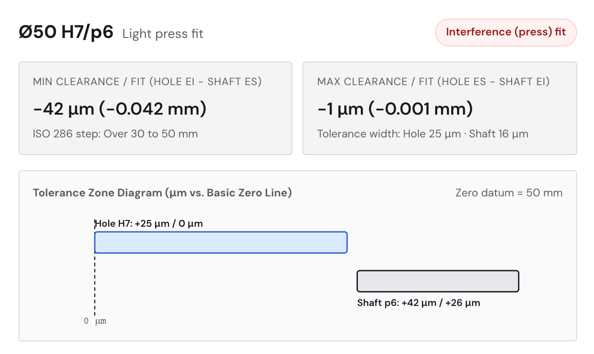

# Engineering Fits

A zero-dependency JavaScript library for CNC drawings and process planning. Calculate hole and shaft limits, look up cutting and forming pilots, and generate drawing notes for tapped and clearance holes. The same calculation modules power Velcurium’s online tools.

[Live ISO 286 calculator and tolerance-zone diagram](https://velcurium.com/tools/iso-286-tolerance-calculator) · [Live tap-drill and clearance-hole calculator](https://velcurium.com/tools/tap-drill-clearance-hole)



## Use the package

The package exposes native ES modules and includes TypeScript declarations. Node.js 18 or later can run the examples, tests and CSV generator. From a local checkout, create the installable archive with one command.

```sh
npm pack
```

From the consuming project, install the resulting file.

```sh
npm install /path/to/velcurium-engineering-fits-0.1.0.tgz
```

### A sliding fit at 25 mm

```js
import { calculateFit, calculateToleranceBand } from '@velcurium/engineering-fits';

const fit = calculateFit(25, 'H7', 'g6');
console.log(fit.hole.minMm, fit.hole.maxMm);     // 25, 25.021
console.log(fit.shaft.minMm, fit.shaft.maxMm);   // 24.980, 24.993
console.log(fit.minClearanceUm, fit.maxClearanceUm, fit.fitType); // 7, 41, 'clearance'
console.log(fit.callout);
// Bore Ø25 H7 (+0.021/0.000) · Shaft Ø25 g6 (-0.007/-0.020) mm — H7/g6 (Clearance fit)

const band = calculateToleranceBand(10, 'js6');
console.log(band.lowerUm, band.upperUm);         // -4.5, 4.5
```

### Cutting, forming and clearance holes

```js
import {
  getThreadSpec, computeEngagementAdvice, formatThreadCallout
} from '@velcurium/engineering-fits';

const metric = getThreadSpec('M6x1.0');
console.log(metric.cuttingTap.mm, metric.formingTap.mm); // 5.00, 5.55
const depth = computeEngagementAdvice(metric, 'aluminum');
console.log(depth.minThreadDepthMm, depth.recommendedBlindDrillDepthMm); // 9, 12.5

const inch = getThreadSpec('1-4-20-unc');
console.log(inch.clearance.normal.drill, inch.clearance.normal.in); // 9/32", 0.28125
console.log(formatThreadCallout(inch, 'steel', 'clearance_normal'));
// Ø0.281–0.290 in THRU — NORMAL CLEARANCE FOR 1/4-20 UNC (ASME B18.2.8)
```

## Public API

| Function | Result |
| --- | --- |
| `calculateToleranceBand(diameterMm, code)` | Upper and lower deviations, IT width, limit sizes in mm and inches, and the diameter interval used. |
| `calculateFit(diameterMm, holeClass?, shaftClass?)` | Both bands, signed minimum and maximum clearance, the fit category at that diameter, and a copyable drawing callout. Defaults to `H7/g6`. |
| `getThreadSpec(id?)` | A shared, read-only thread record with a cutting pilot, forming pilot and three clearance sizes. Defaults to `M6x1.0`. |
| `computeEngagementAdvice(spec, materialKey?)` | Full-thread length and estimated full-diameter blind-drill depth in mm and inches. Defaults to `aluminum`. |
| `formatThreadCallout(spec, materialKey?, holeType?)` | A tapped-hole planning note or a through-hole clearance callout. Defaults to `tapped_cutting`. |

The read-only catalogs are `HOLE_CLASSES`, `SHAFT_CLASSES`, `PREFERRED_FITS`, `THREAD_SPECS` and `MATERIAL_ENGAGEMENT`. Use `THREAD_SPECS.map(s => s.id)` for the accepted thread IDs. Metric IDs use an ASCII `x` and preserve the catalog pitch spelling, for example `M8x1.0`. The declarations distinguish metric records from inch records through `spec.system`. [TypeScript declarations](index.d.ts)

**Fits.** Supply a nominal diameter in mm from 1 through 500, inclusive. A diameter at a step boundary uses the interval ending at that diameter. The API accepts numbers and numeric strings. Hole letters are `H G F E D JS K M N P` and shaft letters are `h g f e d c js k m n p s`. Supported grades are IT5 through IT11, subject to size restrictions. K9 through K11 end at 3 mm. N9 through N11 require a diameter above 1 mm. Invalid diameters and undefined class/size combinations throw. The class catalogs list the choices in the live calculator.

Minimum clearance is the smallest hole minus the largest shaft. Maximum clearance is the largest hole minus the smallest shaft. A minimum of zero or greater gives a clearance fit. A maximum of zero or less gives an interference fit. A range spanning both signs gives a transition fit. For example, `H7/p6` spans −12 to +4 µm at 2 mm and −42 to −1 µm at 50 mm. Use the calculated `fitType` for the specified diameter.

**Threads.** The catalog covers 16 metric coarse, 8 metric fine, 10 UNC and 8 UNF threads. Clearance selections are `close`, `normal` and `loose`. Metric entries give nominal diameters. Inch entries give the nominal stock drill and finished minimum and maximum diameters. Metric counterbores are planning examples whose dimensions depend on the actual screw head.

**Planning notes.** Material keys are `steel`, `stainless`, `aluminum`, `brass` and `plastic`. The engagement estimate multiplies nominal major diameter by the selected material factor. The blind-drill estimate adds 3.5 pitches of full-diameter depth and excludes the drill point. Check joint loads, actual tap lead and chip clearance before releasing a drawing. Confirm forming pilots with the tap manufacturer for the actual material and tool.

The five callout modes are `tapped_cutting`, `tapped_forming`, `clearance_close`, `clearance_normal` and `clearance_loose`. Cutting notes use internal thread class 6H for metric and 2B for Unified. Forming notes defer the class to the drawing. Clearance notes specify a through hole.

## CSV downloads

| File | Contents |
| --- | --- |
| [ISO 286 preferred fits](data/iso286-preferred-fits.csv) | 448 rows covering 16 preferred fits at 28 selected diameters from 1 to 500 mm. Limit sizes use mm. Signed deviations and clearances use µm, including half-micrometre values. |
| [Tap drills and clearance holes](data/tap-drill-clearance-holes.csv) | 126 rows covering 42 threads and three clearance fits per thread. Filter by `thread_id` and `clearance_fit`. Cutting and forming drill sizes are repeated for each fit. |

The thread CSV uses `diameter_unit` for numeric diameter and finished-limit columns. `pitch_mm` always uses mm and `tpi` is populated only for inch threads. The drill-name fields preserve the stock designation, including metric stock used for an inch tap. A blank finished limit marks a metric nominal-only entry. Converted recurring decimals are rounded to six places in the CSV. Both files use UTF-8, comma separators and CRLF line endings.

## Verify or regenerate

Run from the project root. The tests and generator work offline.

```sh
npm test
npm run data:check
npm run data:generate
```

The tests cover benchmark dimensions, every selectable hole/shaft pair at diameter boundaries, both signs of clearance, half-micrometre callouts, inch finished-hole limits and both CSV exports. `data:check` exits with an error if a committed CSV is missing or differs from a fresh calculation. With TypeScript installed, check the declaration examples with `tsc --noEmit --strict --target ES2022 --module NodeNext tests/types.mts`.

## Engineering references and license

- Fits use the ISO 286 size steps, IT widths and limit deviations for the implemented classes. [ISO 286-1:2010](https://www.iso.org/standard/45975.html) · [ISO 286-2:2010](https://www.iso.org/standard/54915.html)
- Metric clearance nominal sizes follow ISO 273. The Unified thread designations and inch clearance limits have separate references. [ISO 273](https://www.iso.org/standard/4183.html) · [ASME B1.1](https://www.asme.org/codes-standards/find-codes-standards/b1-1-unified-inch-screw-threads-un-unr-thread-form) · [ASME B18.2.8-1999 (S2021)](https://webstore.ansi.org/standards/asme/asmeb181999s2021)
- The metric cutting-pilot reference follows DIN 336. Metric forming pilots use the Vergnano recommendations and the Gühring product reference for M1.6 × 0.35. Inch forming pilots follow the Haas chart. [Vergnano cutting taps](https://vergnano.com/en/technical-information/drill-size-cutting-taps/) · [Vergnano forming taps](https://vergnano.com/en/technical-information/drill-size-forming-taps/) · [Gühring M1.6](https://guhring.com/ProductsServices/SizeDetails?EDP=9009210016000) · [Haas roll-tap drill sizes](https://haascnc.com/content/dam/haascnc/ecommerce-assets/linedrawings/threading/taps/plp_assets/Roll%20Tap%20Drill%20Size%20Chart%20Tech%20Doc.pdf)

Verify dimensions critical to safety or acceptance against the released drawing and the applicable edition of the standard.

Velcurium licenses its original implementation, declarations, generator and tests under the MIT License. Standards publications and manufacturer charts retain their respective rights. Check the applicable permissions before redistributing sourced lookup data, including data in generated exports. [MIT License](LICENSE) · [ISO copyright](https://www.iso.org/copyright.html) · [ASME permissions](https://www.asme.org/codes-standards/find-codes-standards/use-of-asme-copyrighted-information)

Maintained by Velcurium for custom CNC machining and D28 modular tooling. [Velcurium](https://velcurium.com) · [2–80 mm free-material sample program](https://velcurium.com/free-sample) · [D28 modular tooling](https://velcurium.com/solutions/d28-modular-welding-tables)
